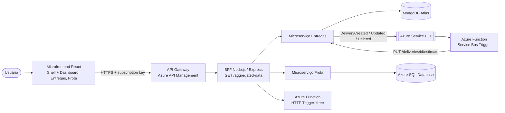

# CloudLog · Microfrontend (React)

Projeto PJBL da disciplina **Arquitetura de Software e Soluções Cloud** (PUCPR) - Prof. Manoel Valerio da Silveira Neto.

## Alunos

- Camilla Augusta Uber
- João Davi
- Laura Guillarducci

## Sobre

Interface web (SPA) do CloudLog organizada como **microfrontends**. Ela **só consome o BFF**, sempre passando pelo
**API Gateway (Azure API Management)**, e nunca chama os microserviços diretamente.

- **Shell** (`src/shell`): menu, roteamento e carregamento sob demanda dos microfrontends. Também mostra as últimas chamadas ao gateway.
- **MFE Painel** (`<cloudlog-dashboard>`): consome `GET /aggregated-data` e mostra KPIs, status das fontes e o JSON agregado.
- **MFE Entregas** (`<cloudlog-entregas>`): CRUD de entregas, simulação de frete (Function) e despacho (regra de negócio no BFF).
- **MFE Frota** (`<cloudlog-frota>`): CRUD de veículos e motoristas.

Cada microfrontend é um módulo ES separado (`dist/mfe/*.js`) que registra um **Web Component** feito em React.
Eles trocam avisos por eventos do navegador (`cloudlog:changed`), sem depender uns dos outros.

## Arquitetura da solução



| Projeto | Repositório |
|---|---|
| Microfrontend (React) | [cloudlog-frontend](https://github.com/laducci/cloudlog-frontend) |
| BFF (Node.js/Express) | [cloudlog-bff](https://github.com/laducci/cloudlog-bff) |
| Microserviço de Entregas (MongoDB) | [cloudlog-entregas-service](https://github.com/laducci/cloudlog-entregas-service) |
| Microserviço de Frota (Azure SQL) | [cloudlog-frota-service](https://github.com/laducci/cloudlog-frota-service) |
| Azure Function (frete + eventos) | [cloudlog-function](https://github.com/laducci/cloudlog-function) |

## Tecnologias

- React 18 + TypeScript + Vite 5
- Web Components (integração dos microfrontends)
- Azure Storage (site estático) para hospedar
- Azure API Management (header `Ocp-Apim-Subscription-Key`)

## Endereços na nuvem

| Recurso | URL |
|---|---|
| Frontend (microfrontend) | https://stcloudlogweba6058.z15.web.core.windows.net |
| API Gateway (Azure API Management) | https://apim-cloudlog-a6058.azure-api.net/cloudlog/aggregated-data (header `Ocp-Apim-Subscription-Key`) |
| BFF · Swagger | https://ca-cloudlog-bff.delightfulbeach-476aeb68.brazilsouth.azurecontainerapps.io/docs |
| Microserviço Entregas · Swagger | https://ca-cloudlog-entregas.delightfulbeach-476aeb68.brazilsouth.azurecontainerapps.io/docs |
| Eventos (AsyncAPI) | https://ca-cloudlog-entregas.delightfulbeach-476aeb68.brazilsouth.azurecontainerapps.io/events/docs |
| Microserviço Frota · Swagger | https://ca-cloudlog-frota.delightfulbeach-476aeb68.brazilsouth.azurecontainerapps.io/docs |
| Azure Function · Swagger | https://func-cloudlog-a6058.azurewebsites.net/api/docs |
| Docker Hub | https://hub.docker.com/u/laducci |

## Como rodar localmente

```bash
npm install
npm run build              # gera o shell (dist/) e os microfrontends (dist/mfe/)
# edite dist/config.js com a URL do API Gateway (ou do BFF local) e a chave
npx vite preview           # http://localhost:4173
```

A URL do gateway fica em `config.js` (carregado em tempo de execução), então a mesma build serve para qualquer ambiente.
